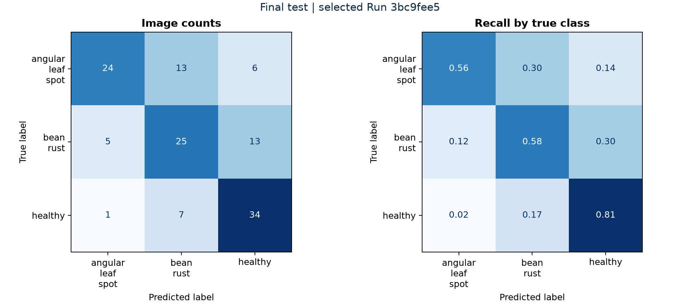

# MLOps Project Notes

## 1. Configuration and Reproducibility

### params.yaml

To reproduce a test using the exact same parameters used before for reproducibility.

### pyproject.toml

Make sure the users have the same versions of dependencies before running the project.

### uv-lock

All environments consume the same locked resolution, making the Python software stack reproducible across compatible environments.

### .venv

Local virtual environment that keeps a project's packages and dependencies separate from the global Python installation.

### Reproducibility

Missing seed generator which prevents the model from generating a repeatable result as before. Making it hard for testing multiple times.

## 2. Data Validation and Provenance

### Provenance and Train

Training runs lack provenance manifests (Git SHA, dirty flag, package versions, data identity) and MLflow experiment/model logging | Capture environment/Git/data metadata in `reports/run_manifest.json` and log parameters, datasets, metrics, artifacts, and the model to MLflow.

### Validate_data

Missing pre-training data quality gate; corrupted images, wrong split counts, or missing classes are not caught before training.

### data

Transform data according to the needed shape before training. Avoiding missing data or unnormalized data in loaders.

## 3. Engineering Checkpoints

### Engineering checkpoint 1: Why is a working model.pt insufficient evidence that an experiment is reproducible?

The model is already done and ready to be used but other users couldn't know the parameters used in order to train it.

### Engineering Checkpoint 2: Does random_state=42 guarantee bit-for-bit identical results on every CPU/GPU/software stack?

No because each stack have different levels of precision, so there might be a minor numerical difference at the least significant bit.

### Engineering Checkpoint 3: In one sentence each, state what the Git remote stores, what the DVC remote stores, and whether git push transfers the DVC-managed raw images. 


- **Git remote stores:** source code, params.yaml,pyproject.toml, uv.lock and .dvc metadata pointers.
- **DVC remote stores:** Large model artefacts,large generated files, DVC-managed dataset content.
- **Git push:** Git push doesn't push the whole dataset in the repository, instead it pushes the metadata required to pull the dataset from dvc.

## 4. Pipeline Execution

### 4.2

1. Yes, validate runs first for quality check, if it fails, prepare will not run.
2. Yes, directly reads and processes the raw image files from data/raw.
3. data.image_size, all the items under train, augmentation, compute, tracking sections.
4. evaluate does not depend on the train stage directly; instead, it fetches a specific candidate model from MLflow using the Run ID stored in selection.run_id. Tracking selection.run_id in params: ensures DVC knows the current test outputs are stale and automatically reruns evaluate whenever you select a different MLflow Run ID.
5. reports/test_metrics.json

### Engineering Checkpoint 4: In one sentence per tool, explain what Git, DVC and MLflow each record about a
training Run.

- **Git:** Records the exact versioned source code, pipeline definitions (dvc.yaml), and configuration settings (params.yaml) used for the run.
- **DVC:** Records cryptographic hashes of the raw and processed datasets, stage dependencies, and output artifacts (dvc.lock) to track data lineage and verify pipeline reproducibility.
- **MLflow:** Records per-run execution telemetry—including hyperparameters, dataset inputs, epoch-by-epoch metrics, training duration, provenance artifacts, and the serialized model binary with its signature—in an experiment tracking store.

## 5. DVC Change Detection and Pipeline Reuse

### Change Detection Table

| Change | VALIDATE | PREPARE | TRAIN | EVALUATE |
| :--- | :--- | :--- | :--- | :--- |
| Change `train.learning_rate` | REUSED | REUSED | RERUN | REUSED |
| Change `data.image_size` | REUSED | RERUN | RERUN | NEEDS UPDATE |
| Edit `src/validate_data.py`; the quality report stays the same | RERUN | REUSED | REUSED | REUSED |
| Edit only `README.md` | REUSED | REUSED | REUSED | REUSED |

### Engineering Checkpoint 5: Explain your labels for at least two rows: one setting change and one file edit. For
each stage in those rows, name the input that changes or explain why its inputs stay the same. Use your dvc.yaml
for this explanation.

### Change train.learning_rate

- **VALIDATE & PREPARE (REUSED):** Neither stage lists train.learning_rate in its params: or deps:, so their inputs are unchanged.
- **TRAIN (RERUN):** Lists train.learning_rate under params:, so DVC detects a parameter change and reruns training.
- **EVALUATE (REUSED):** Does not depend on train or train.learning_rate, and selection.run_id remains fixed to the previously selected MLflow Run.

### Edit src/validate_data.py;

- **VALIDATE (RERUN):** src/validate_data.py is in validate's deps:, so DVC reruns validate.
- **PREPARE, TRAIN, EVALUATE (REUSED):** Because reports/data_quality.json is deterministic and its content does not change after validate finishes, prepare's input dependency (reports/data_quality.json) is unchanged, so DVC skips all downstream stages.

## 6. Experiment Runs

### Run A

`444e84db7f354cb68951427e02bf946c`

- Running it again without changes skips every stage.
- Running it after adding a comment reruns validate and reuse the else.

### Run B

`3bc9fee5a81f45ccbb66038acb05fda2`

### Pipeline Execution Results

| Check | Relevant Terminal Lines | VALIDATE | PREPARE | TRAIN | EVALUATE |
| :--- | :--- | :--- | :--- | :--- | :--- |
| **1. Run again without changing anything** | `Stage 'validate' didn't change, skipping` / `Stage 'prepare' didn't change, skipping` / `Stage 'train' didn't change, skipping` / `Data and pipelines are up to date.` | REUSED | REUSED | REUSED | NOT RUN |
| **2. Add a comment to `src/validate_data.py` (report unchanged)** | `Running stage 'validate': > uv run --locked python -m src.validate_data` / `Stage 'prepare' didn't change, skipping` / `Stage 'train' didn't change, skipping` | RERUN | REUSED | REUSED | NOT RUN |
| **3. Change `train.learning_rate` (or Run B param)** | `Stage 'validate' didn't change, skipping` / `Stage 'prepare' didn't change, skipping` / `Running stage 'train': > uv run --locked python -m src.train` | REUSED | REUSED | RERUN | NOT RUN |
| **4. Change `data.image_size`** | `Stage 'validate' didn't change, skipping` / `Running stage 'prepare': > uv run --locked python -m src.prepare` / `Running stage 'train': > uv run --locked python -m src.train` | REUSED | RERUN | RERUN | NOT RUN |

## 7. Experiment Comparison

Setting augmentation.enabled: true isolates the effect of random data augmentations -> Slightly higher train_loss.

### Experiment Results

| Run | Controlled change | Val. Accuracy | Val. Macro-F1 | Training time | MLflow Run ID |
| :--- | :--- | :--- | :--- | :--- | :--- |
| **A** | Baseline (`lr=0.001`, `augmentation.enabled=false`, `dropout=0.30`, `batch_size=32`) | `0.6390977443609023` | `0.625419004269433` | `9.853514299960807s` | `444e84db7f354cb68951427e02bf946c` |
| **B** | Change `train.learning_rate` (`0.001` → `0.003`) | `0.6917293233082706` | `0.6772352509225436` | `12.910993000026792s` | `3bc9fee5a81f45ccbb66038acb05fda2` |
| **C** | Reset `lr=0.001`; enable data augmentation (`augmentation.enabled: false` → `true`) | `0.6541353383458647` | `0.6416042962918432` | `13.444834900088608s` | `13260c249a9542999306031609e6368f` |

### Engineering Checkpoint 6: Justify the primary metric you chose for this three-class problem. Explain why you use the test set only after choosing a model.

Primary metric: val_macro_f1 because it computes the harmonic mean of precision and recall separately for each class and averages them unweighted.

## 8. Final Model Selection and Test Results

### Selected Run B

Run B is chosen with id: `3bc9fee5a81f45ccbb66038acb05fda2`

highest val_accuray,val_macro_f1= `0.6772352509225436`

### Confusion Matrix



### Test Metrics

```json
{
  "selected_run_id": "3bc9fee5a81f45ccbb66038acb05fda2",
  "test_accuracy": 0.6484375,
  "test_macro_f1": 0.6471685128137904,
  "training_data_identity": "8fa943ff6c17a3c874d2b152e9d7980602a5cd50c0d8156625bd00590a3d8c6c"
}
```